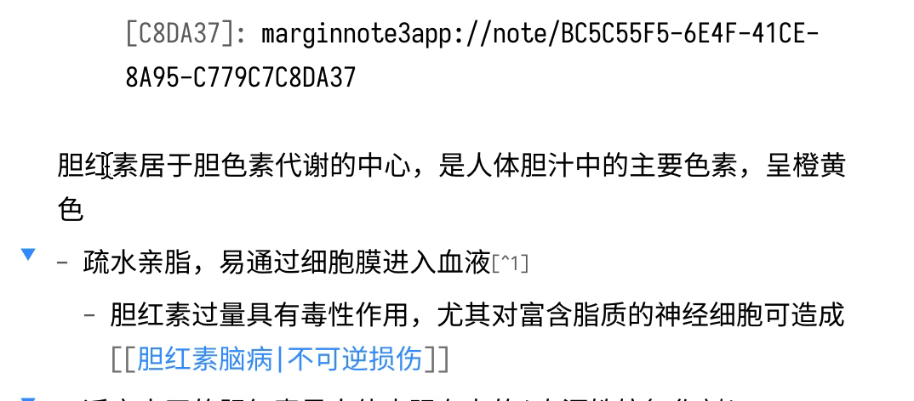
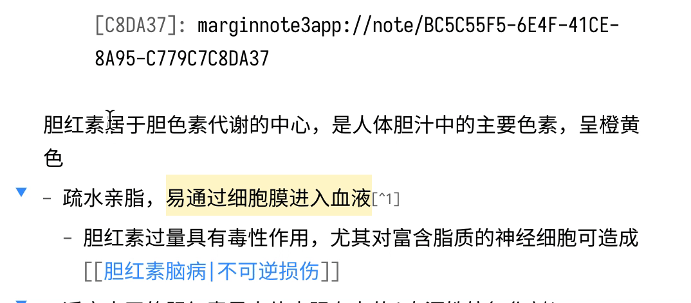

# Simplified Chinese Word Splitting

Adds Simplified Chinese word splitting support for the editor and Vim mode for Obsidian.md

增加 Obsidian 内置编辑器的(简体)中文分词支持，使得编辑模式的双击可以选中中文，以及在 Vim 模式下可以按中文分词移动光标

Special Thanks to [@fengkx](https://github.com/fengkx) for [jieba-wasm module](https://github.com/fengkx/jieba-wasm)
感谢 [@jiyee](https://github.com/jiyee) 实现的Vim分词支持！

注意：从 v1.8.0 开始，默认分词引擎由结巴分词更换为系统自带分词引擎，结巴分词不再是必备组件，若你需要结合 [omnisearch](https://github.com/scambier/obsidian-omnisearch) 插件使用，或仍需要使用结巴分词提供的更精确的分词结果，以及新词发现、自定义词库功能，请在设置打开选项后，按照弹窗提示进行安装（若系统不提供分词引擎，无论选项是否打开，本插件仍会提示安装结巴分词）

## Demo

| Obsidian's Default Word Splitting<br>默认分词 | Patched<br>安装插件后                     |
| --------------------------------------------- | ----------------------------------------- |
|     |  |

## Jieba component storage 结巴分词组件存储

The jieba WASM binary is cached in IndexedDB using `idb`, keyed by the jieba-wasm version. Vaults sharing the same Obsidian browser origin and storage partition reuse the cache. Separate devices and storage partitions need their own installation; Obsidian Sync does not sync this cache.

Open the plugin settings and choose **安装或导入结巴分词组件** to download the component or import a local `.wasm` file. If you previously installed the component as a file, import it once using this picker.

Choose **管理结巴分词缓存** to manually delete cached versions or old WASM files. Deleting a shared cache affects every vault using it; restart Obsidian afterward.

结巴分词 WASM 按版本缓存在 IndexedDB 中。同一浏览器源和存储分区内的库可共享缓存，不同设备需分别安装，Obsidian Sync 不会同步此缓存。

在插件设置选择「安装或导入结巴分词组件」，可自动下载或导入本地 `.wasm` 文件。此前以文件形式安装的组件需手动导入一次。

选择「管理结巴分词缓存」可手动删除各版本缓存或旧 WASM 文件。删除共享缓存会影响所有使用它的库，重启 Obsidian 后生效。

## Installation 安装

### From Obsidian

1. Open `Settings` > `Third-party plugin`
2. Make sure Safe mode is **off**
3. Click `Browse community plugins`
4. Search for this plugin `Simplified Chinese Word Splitting`
5. Click `Install`
6. Once installed, close the community plugins window and the patch is ready to use.

---

1. 打开`设置`>`第三方插件`
2. 确保安全模式为`关闭`
3. 点击`浏览社区插件`
4. 搜索此插件 `Word Splitting for Simplified Chinese in Edit Mode and Vim Mode`
5. 点击`安装`
6. 安装完成后，关闭安装窗口，插件即可使用

### From GitHub

1. Download the Latest Release from the Releases section of the GitHub Repository
2. Put files to your vault's plugins folder: `<vault>/.obsidian/plugins/cm-chs-patch`
3. Reload Obsidian
4. If prompted about Safe Mode, you can disable safe mode and enable the plugin.
   Otherwise head to Settings, third-party plugins, make sure safe mode is off and
   enable the plugin from there.

> Note: The `.obsidian` folder may be hidden. On macOS you should be able to press `Command+Shift+Dot` to show the folder in Finder.

---

1. 从 GitHub 仓库的 Releases 下载最新版本
2. 把文件放在对应 Vault 的插件文件夹下：`<vault>/.obsidian/plugins/cm-chs-patch`
3. 重新加载 Obsidian
4. 如果出现有关安全模式的提示，则可以禁用安全模式并启用插件。否则，请转到`设置`→`第三方插件`，确保关闭安全模式，然后从`第三方插件`启用插件

> 注意，`.obsidian` 文件夹为隐藏文件夹，在 macOS 的 Finder 下可以按 `Command+Shift+.` 以显示隐藏文件夹

## Development

### Prerequisites

- **Node.js 26+** — pinned in [`mise.toml`](mise.toml); the easiest way to provision it is [mise](https://mise.jdx.dev).
- **pnpm 11.0.9** — pinned in `mise.toml` and `packageManager` in `package.json`.
- **Git**.

### One-time setup

```bash
# 1. Clone the repository.
git clone https://github.com/aidenlx/cm-chs-patch.git

cd cm-chs-patch

# 2. Provision Node 26 + pnpm (skip if you manage Node yourself).
mise install

# 3. Install dependencies.
pnpm install
```

### Scripts

| Command              | Purpose                                                                                               |
| -------------------- | ----------------------------------------------------------------------------------------------------- |
| `pnpm dev`           | Vite watch build to `build/`; also writes `.hotreload` for the Obsidian Hot-Reload plugin             |
| `pnpm build`         | Production bundle to `build/main.js`; the version from `package.json` is stamped onto `manifest.json` |
| `pnpm typecheck`     | `tsc --noEmit`                                                                                        |
| `pnpm lint`          | oxlint (`pnpm lint:fix` to autofix)                                                                   |
| `pnpm lint:obsidian` | Obsidian policy checks only; general linting stays in oxlint                                          |
| `pnpm format`        | oxfmt check (`pnpm format:fix` to apply)                                                              |
| `pnpm test`          | Versioned IndexedDB cache regression checks                                                           |
| `pnpm review:plugin` | Official Obsidian plugin review, with a local summary under `.scratch/obsidian-review/`               |
| `pnpm release`       | release-it (maintainers only)                                                                         |

### Loading the build into Obsidian

Symlink (or copy) `build/` into a test vault as `<vault>/.obsidian/plugins/cm-chs-patch`, then enable the plugin in Obsidian's Community Plugins settings. With [Hot-Reload](https://github.com/pjeby/hot-reload) installed in the same vault, `pnpm dev` triggers live reloads on rebuild.

### Target Obsidian version

This release targets Obsidian 1.14.4, with `@codemirror/view` 6.43.13 and `@codemirror/state` 6.7.6, as specified by that Obsidian API package.

### Plugin review environment

The PR workflow and `pnpm review:plugin` run the official [Obsidian Workflows](https://github.com/obsidianmd/obsidian-workflows) reviewer at the same pinned revision. Both run `pnpm lint:obsidian` for Obsidian policy rules and `pnpm lint` for general code checks through oxlint. The reviewer's bundled ESLint pass is disabled to avoid duplicating general lint rules. The local command downloads the bundled reviewer. It runs PR checks only and writes `.scratch/obsidian-review/summary.md`; it does not publish a release. Obsidian ESLint errors fail the local command and CI. Other official policy findings are advisory; build and validation failures fail the run.

`src/vim.js` is an unmodified reference from Obsidian 1.14.4's `lib/codemirror/vim.js`, with a provenance header, and is not bundled. `src/vim-utils.js` contains copied helpers plus marked Chinese segmentation changes. The upstream reference and copied helper file are excluded from ESLint and oxlint through configuration-level ignores; the plugin-authored Vim wrapper remains checked.
